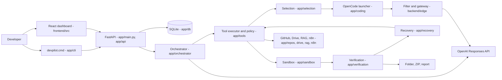

# DevPilot AI repository structure

The tracked files of `feature/evaluation-upgrade`, checked on 6 November 2026. Git internals, virtual environments, `node_modules`, caches, secrets, `.env` files and runtime data are left out.

## 1. Repository tree

```text
AutoDev-GPT/
├── .github/
│   └── workflows/
│       └── ci.yml                      backend on Windows (Python 3.12), frontend on Ubuntu (Node 24)
├── backend/
│   ├── app/
│   │   ├── __main__.py                 `python -m app`: serves the FastAPI app with uvicorn
│   │   ├── main.py                     create_app(): routers, orchestrator, coding runtime, integrations
│   │   ├── config.py                   Settings (pydantic-settings), read from .env for the developer backend
│   │   ├── integrations.py             GitHub, Drive, RAG and n8n wiring
│   │   ├── plan_cli.py                 planning-only command line (real GPT, no coding)
│   │   ├── api/                        REST routes: projects, runs, approvals, budget, capabilities, artifacts,
│   │   │                               history, resources, tools, github, knowledge, n8n, evaluation, session, health
│   │   ├── cli/                        the devpilot command: main, setup, doctor, build, inspect_cmd, verify_site,
│   │   │                               engine, credentials (DPAPI), github_token, userconfig, paths, runtime,
│   │   │                               image_audit, webruntime, Dockerfile.runtime
│   │   ├── orchestrator/               llm_client (Responses API), loop, state_machine, prompts, budget,
│   │   │                               approvals, run_manager, run_control, start_policy, fake_llm
│   │   ├── coding/                     launcher, opencode_container, opencode_policy, opencode_contract,
│   │   │                               opencode_tools, session_control, guard_process, container_stop,
│   │   │                               candidate, attempt_store, audit, brief, simulated
│   │   ├── sandbox/                    docker_cli, runner (DockerSandbox), policy, spec, process, replay, fake
│   │   ├── verification/               recipes, acceptance, browser_acceptance, web, artifact, report, results
│   │   ├── recovery/                   diagnosis, engine, policy
│   │   ├── selection/                  adaptive, selector, catalog, history, model
│   │   ├── tools/                      registry, executor, gates, policy, base
│   │   │   └── adapters/               coding, opencode, sandbox, workspace_fs, repositories, drive, gap,
│   │   │                               github_publish, n8n, catalog
│   │   ├── repos/                      github_url, github_access, github_oauth, github_write, importer,
│   │   │                               inspect, evaluate, licenses
│   │   ├── sources/                    discover, check, events: links a request names
│   │   ├── drive/                      oauth, access, persistent, source, model
│   │   ├── rag/                        extract, parsers, parsing, chunking, index, sqlite_index, embeddings,
│   │   │                               openai_embedder, grounded, knowledge, selection, blueprint
│   │   ├── n8n/                        client, runtime, signing, workflows
│   │   ├── evaluation/                 github_publish, gaps, agent_tools, tool_explain
│   │   ├── toolcatalog/                catalog, live, model
│   │   ├── stacks/                     catalog.py, catalog.yaml
│   │   ├── db/                         models, repositories, session
│   │   ├── core/                       auth, sessions, egress, redaction, secret_store, events, logging
│   │   ├── schemas/                    api.py
│   │   ├── demo/                       offline demonstrations and benchmarks
│   │   └── ui/                         built-in static page
│   ├── edge/                           filter_policy, filter_server, gateway_policy, gateway_server, install_proxy
│   ├── sandbox_images/
│   │   ├── verify-web/                 Chromium website verifier
│   │   ├── verify-react/               React + Vite verifier definition
│   │   ├── verify-fastapi/             FastAPI verifier definition
│   │   └── document-parser/            isolated PDF and DOCX parser
│   ├── scripts/                        live_server, live_build, live_demo, live_smoke_test, fetch_opencode,
│   │   │                               check_openai_access, demo_calculator, demo_sandbox, opencode_*_check
│   │   └── opencode_check/
│   ├── tests/
│   │   ├── unit/                       107 test modules
│   │   ├── integration/                API, orchestration, end-to-end and Docker scenarios
│   │   ├── live/                       opt-in OpenAI and n8n tests
│   │   └── fixtures/
│   ├── pyproject.toml                  package metadata; `devpilot = app.cli.main:main`
│   └── requirements.lock               pinned dependencies
├── config/
│   ├── egress_allowlist.yaml           every host each component may reach
│   ├── tool_catalog.yaml               tools, capabilities and connectivity
│   └── n8n_workflows.yaml              workflows GPT may trigger
├── docs/                               architecture, installation, security, status, progress, structure
├── examples/
│   ├── prompts.md
│   └── competition-2026/               summaries of the four LTID 2026 competition packages
├── frontend/
│   ├── public/
│   ├── src/
│   │   ├── main.tsx                    mounts the app
│   │   ├── App.tsx                     routes and layout
│   │   ├── components/                 Composer, PermissionDialog, Timeline, ActivityPanel, ApprovalPanel,
│   │   │   │                           BudgetIndicator, DeliveryCard, FileBrowser, GitHubPublishCard, ...
│   │   │   └── layout/
│   │   ├── pages/                      Home, Projects, ProjectDetail, Runs, RunDetail, Tools, Templates
│   │   ├── lib/                        api client, types, queries, readiness, timeline, delivery, session
│   │   └── test/                       render helpers, fixtures, setup
│   ├── index.html
│   ├── package.json, package-lock.json
│   ├── vite.config.ts, tsconfig*.json, eslint.config.js
│   └── README.md
├── n8n/
│   ├── workflows/                      devpilot-echo, devpilot-notify, devpilot-run-events
│   └── README.md
├── scripts/
│   ├── dev-env.ps1                     developer session: TEMP, pip cache, interpreter
│   └── n8n-local.ps1                   local n8n instance
├── .env.example                        developer backend settings template
├── CLAUDE.md                           contributor rules for the repository
├── README.md
├── setup.cmd, setup.ps1                Windows setup
└── devpilot.cmd                        CLI launcher
```

## 2. Major directories

| Path | Purpose |
|---|---|
| `backend/app/api/` | FastAPI routers under `/api/v1`, authenticated by the API token or a dashboard session |
| `backend/app/cli/` | The `devpilot` command: setup, readiness checks, builds, repository inspection, website verification, encrypted key store |
| `backend/app/orchestrator/` | The GPT client, the run loop, the state machine, prompts and the budget that reserves each request's worst case |
| `backend/app/tools/` | The tool registry, strict schemas, phase gates, risk policy and every adapter GPT can call |
| `backend/app/coding/` | The OpenCode launcher and container policy, the managed configuration, attempt records and the guard process |
| `backend/edge/` | The API filter in front of OpenCode, the metered model gateway and the registry-only install proxy |
| `backend/app/sandbox/` | Docker execution of test commands with no network and resource limits |
| `backend/app/verification/` | Stack test recipes, frozen acceptance suites, browser acceptance and the delivery gate |
| `backend/app/recovery/` | Failure diagnosis and the deterministic recovery decision |
| `backend/app/selection/` | Eligibility, utility scoring and verified outcome history for coding tools |
| `backend/app/repos/`, `sources/` | GitHub URLs, access, OAuth, import, inspection and approved writes; link discovery in requests |
| `backend/app/drive/`, `rag/` | Google Drive consent and grants; extraction, chunking, indexes and grounded answers |
| `backend/app/n8n/`, `evaluation/` | Signed n8n workflows; gap triage, document diffs and draft pull requests |
| `backend/app/db/`, `core/`, `schemas/` | Persistence; auth, sessions, egress, redaction and secret storage; API models |
| `backend/sandbox_images/` | Dockerfiles for the website, React, FastAPI and document-parser runtimes |
| `backend/tests/` | Unit, integration and opt-in live suites |
| `frontend/src/` | The React dashboard |
| `config/` | Egress allowlist, tool catalog and n8n workflow catalog |
| `docs/`, `examples/` | Documentation, prompts and the competition summaries |

## 3. Entry points

| Entry point | File | Starts |
|---|---|---|
| Windows setup | `setup.cmd` → `setup.ps1` | Python checks, `.venv`, `pip install -r backend\requirements.lock`, then `python -m app.cli setup` |
| CLI | `devpilot.cmd` → `python -m app.cli` | `backend/app/cli/main.py` (`main()`); also installed as the `devpilot` script |
| FastAPI backend | `python -m app` from `backend/` | `backend/app/__main__.py` → `create_app()` in `backend/app/main.py` |
| Live dashboard session | `backend/scripts/live_server.py` | The backend with the real coding engine, after a preflight and a typed approval |
| React frontend | `npm run dev` in `frontend/` | `frontend/src/main.tsx` → `App.tsx`; Vite proxies `/api` to the backend |
| CI | `.github/workflows/ci.yml` | Backend pytest on Windows; frontend typecheck, lint, Vitest and build on Ubuntu |

## 4. Where things live

- **Integrations.** GitHub: `backend/app/repos/`, `backend/app/api/github.py`, `backend/app/tools/adapters/repositories.py` and `github_publish.py`, with draft pull requests in `backend/app/evaluation/github_publish.py`. Google Drive and RAG: `backend/app/drive/`, `backend/app/rag/`, `backend/app/api/knowledge.py`. n8n: `backend/app/n8n/`, `backend/app/api/n8n.py`, `config/n8n_workflows.yaml`, `n8n/workflows/`, `scripts/n8n-local.ps1`.
- **Security controls.** Tool policy and gates: `backend/app/tools/policy.py`, `gates.py`. Container policy: `backend/app/coding/opencode_container.py`, `opencode_policy.py`, `backend/app/sandbox/policy.py`. Network: `backend/edge/`, `backend/app/core/egress.py`, `config/egress_allowlist.yaml`. Secrets: `backend/app/core/secret_store.py`, `backend/app/cli/credentials.py`, `backend/app/core/redaction.py`. Spending: `backend/app/orchestrator/budget.py`, `backend/app/orchestrator/start_policy.py`, `backend/edge/gateway_policy.py`.
- **Tests.** Backend: `backend/tests/unit/`, `integration/`, `live/` (opt-in). Frontend: `*.test.ts(x)` beside the code, helpers in `frontend/src/test/`.
- **Generated artifacts.** CLI deliveries go to `.\devpilot-output\` (or `--output`): a project folder and ZIP with `MANIFEST.txt`, `DEVPILOT-HOW-TO-RUN.txt` and `devpilot-verification/`. Runtime state lives under `%LOCALAPPDATA%\DevPilot` (or `DEVPILOT_HOME`); see `backend/app/cli/paths.py`.
- **Configuration.** CLI settings: `%LOCALAPPDATA%\DevPilot\config.toml`, written by `devpilot setup`. Developer backend: `.env` from `.env.example`, read by `backend/app/config.py`. Policies: `config/`. Stacks: `backend/app/stacks/catalog.yaml`. Dependencies: `backend/requirements.lock`, `frontend/package.json`.

## 5. Component relationships



Every arrow is a direct call or request in the source: the CLI drives the same FastAPI application in-process, the dashboard calls it over HTTP, and coding tools reach the model only through `backend/edge/`.
