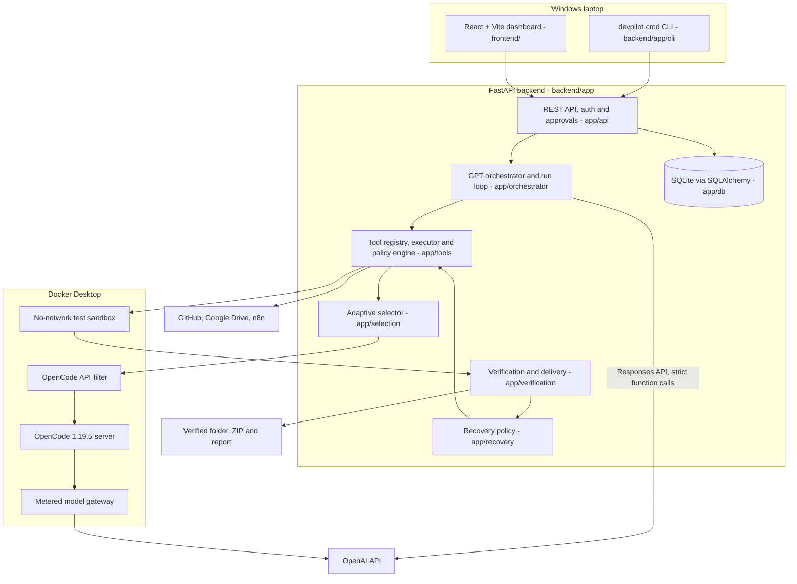
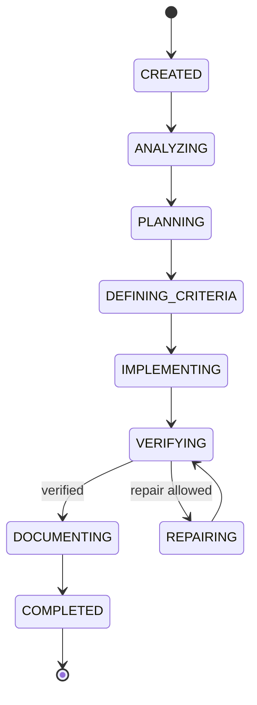
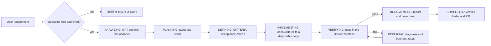
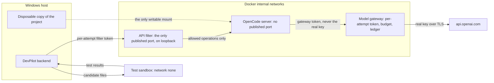
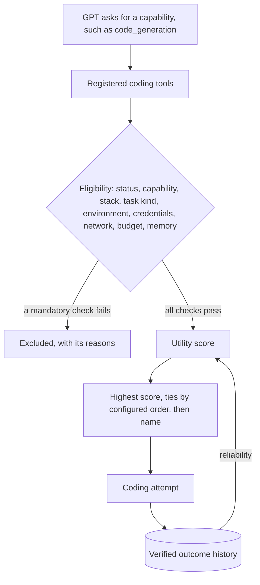
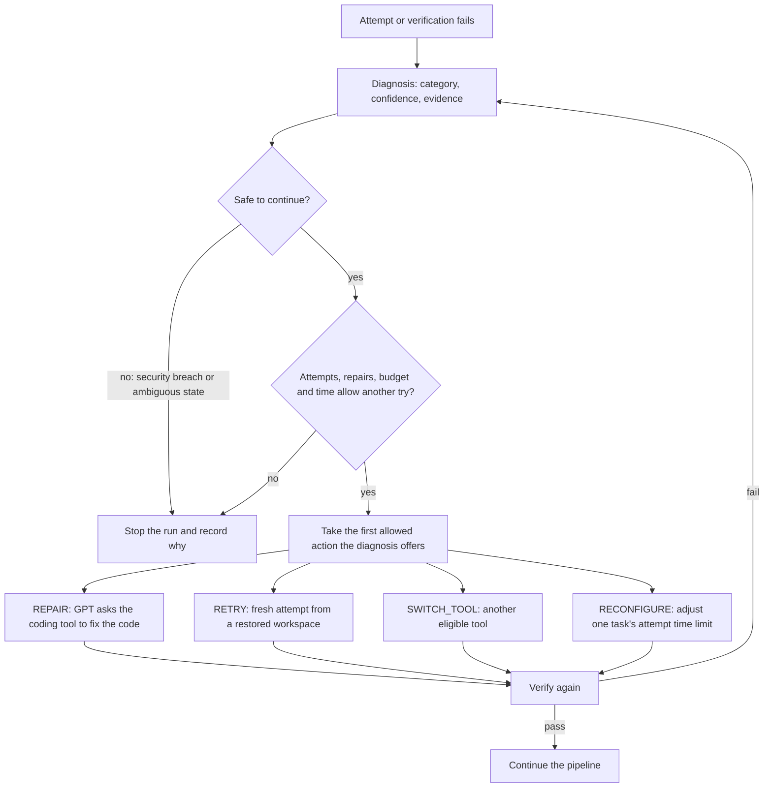
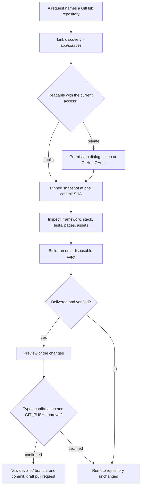
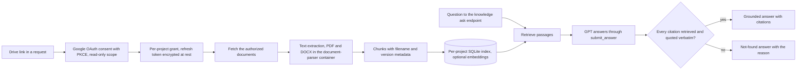
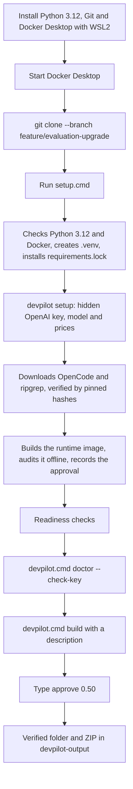

# DevPilot AI (AutoDev-GPT)

**GPT-orchestrated software development with OpenCode, isolated Docker execution, verification-guided delivery and bounded recovery.**

**Repository:** https://github.com/Prudhvisunku14/AutoDev-GPT  
**Documented branch:** [`feature/evaluation-upgrade`](https://github.com/Prudhvisunku14/AutoDev-GPT/tree/feature/evaluation-upgrade)  
**Documentation checked against the source:** 6 November 2026

DevPilot AI turns a plain-language request into a tested, packaged application. A GPT model analyses the request, plans the work and calls tools; **OpenCode** writes the code inside a locked-down container; separate **Docker** sandboxes run the tests; and the **FastAPI** backend decides, in code, what may run, what it may spend and whether the result can be delivered. Everything is driven from a Windows command line (`devpilot.cmd`) or a React dashboard.

## Contents

1. [Overview and objectives](#1-overview-and-objectives)
2. [Capabilities and verification status](#2-capabilities-and-verification-status)
3. [System architecture](#3-system-architecture)
4. [Technologies and their responsibilities](#4-technologies-and-their-responsibilities)
5. [End-to-end development pipeline](#5-end-to-end-development-pipeline)
6. [OpenCode integration and the coding lifecycle](#6-opencode-integration-and-the-coding-lifecycle)
7. [Docker sandbox and security](#7-docker-sandbox-and-security)
8. [Adaptive tool selection](#8-adaptive-tool-selection)
9. [Failure detection, recovery and retry policy](#9-failure-detection-recovery-and-retry-policy)
10. [Verification-guided development](#10-verification-guided-development)
11. [GitHub, Google Drive, RAG and n8n integrations](#11-github-google-drive-rag-and-n8n-integrations)
12. [Installation on Windows 10/11](#12-installation-on-windows-1011)
13. [OpenAI API key, spending limits and approvals](#13-openai-api-key-spending-limits-and-approvals)
14. [CLI usage and examples](#14-cli-usage-and-examples)
15. [React frontend and FastAPI backend](#15-react-frontend-and-fastapi-backend)
16. [Testing and CI](#16-testing-and-ci)
17. [Troubleshooting](#17-troubleshooting)
18. [Repository structure](#18-repository-structure)
19. [Roadmap](#19-roadmap)
20. [Competition examples](#20-competition-examples)
21. [Reference documentation](#21-reference-documentation)

---

## 1. Overview and objectives

DevPilot AI is a tool-using **software-development agent** built around one engineering loop:

**Understand → inspect resources → plan → define acceptance criteria → implement → verify → repair → document → deliver.**

Its objectives:

- **Real engineering, not text generation.** Every build is planned as tasks, written by a coding agent, tested in Docker and packaged only when the checks pass.
- **The backend is the authority.** GPT chooses tools; deterministic code validates every call, enforces phases, permissions and budgets, and decides delivery.
- **Bounded spending.** Nothing is sent to a paid model before the person approves a limit, and the limit is enforced before every model request.
- **Isolation by default.** Generated code never runs on the Windows host during a build: it is written in a container and tested in a no-network sandbox.
- **Evidence for every result.** Each run records its state changes, tool calls, costs, test results and verification report.

Example requests:

- "Create a Python command-line expense tracker with persistent storage and unit tests."
- "Add a `--verbose` option to this tool https://github.com/OWNER/REPOSITORY and add tests."
- "Inspect this GitHub repository and describe its framework, pages and components."
- "Verify this existing static website in Docker with a real browser."

---

## 2. Capabilities and verification status

Each capability is labelled with the strongest evidence recorded for it in [docs/PROGRESS.md](PROGRESS.md) and [docs/FEATURE_STATUS.md](FEATURE_STATUS.md):

- **Live-tested:** ran against the real service, model or containers, with the result recorded.
- **Offline-tested:** covered by automated tests with fakes (scripted GPT, in-process GitHub, Drive, OpenAI and n8n); runs in CI.
- **Opt-in:** implemented and offline-tested; becomes active once you supply the credential, runtime image or service it uses.
- **Planned:** on the [roadmap](#19-roadmap).

| Capability | Status | How to use it |
|---|---|---|
| GPT requirement analysis and planning through strict function calls and code gates | **Live-tested** (real model: analysis 2026-10-29; a 32-requirement, 9-task plan 2026-11-03) | `devpilot.cmd build`, dashboard |
| Docker sandbox isolation: no network, timeout kill, memory limit | **Live-tested** (real containers, 2026-10-30) | Every build |
| OpenCode in real containers behind DevPilot's API filter and model gateway | **Live-tested** with a scripted model (2026-11-01) | Every build |
| Website verification: frozen browser checks in real Chromium, repair, delivery | **Live-tested** with scripted GPT and coding (2026-11-04) | `devpilot.cmd verify-site`, website builds |
| Continuous integration: Windows backend job, Ubuntu frontend job | **Live-tested** on GitHub Actions | Every push |
| Python command-line application builds, end to end (plan → OpenCode → Docker tests → verified ZIP) | **Offline-tested** end to end; each stage above live-tested | `devpilot.cmd build "..."` |
| Static website builds (HTML, CSS, JavaScript) judged by frozen browser acceptance | **Opt-in** after `setup --web` | `devpilot.cmd build "..."` |
| Existing website verification (install, type check, build, serve, browser checks) | **Opt-in** after `setup --web` | `devpilot.cmd verify-site <folder or URL>` |
| GitHub repository inspection and pinned-snapshot import | **Offline-tested** | `devpilot.cmd inspect <URL>`, a URL in a build request |
| Private repositories with a fine-grained token | **Opt-in** | `devpilot.cmd setup --github-token` |
| GitHub OAuth, approval-gated writes and draft pull requests of verified runs | **Opt-in** (GitHub OAuth App) | Dashboard |
| Google Drive OAuth with PKCE, read-only grants, consent persisted across restarts | **Opt-in** (Google OAuth client) | Dashboard, Drive links in requests |
| Grounded RAG answers with every citation checked in code | **Offline-tested** | `POST /api/v1/projects/{id}/knowledge/ask` |
| PDF and DOCX parsing in an isolated parser container | **Opt-in** (`document-parser` image) | Drive ingestion |
| OpenAI embeddings for the per-project SQLite index | **Opt-in** (`RAG_EMBEDDER=openai` and its price) | Drive ingestion |
| n8n signed triggers and callbacks; a waiting run resumed by its callback | **Opt-in** (an n8n instance) | `scripts/n8n-local.ps1` |
| Adaptive tool selection and deterministic recovery policy | **Offline-tested** | Every build |
| Tool catalog, comparisons and recommendations | **Offline-tested** | Dashboard Tools page, `compare_tools` |
| Source-to-requirement gap triage and document-version diff | **Offline-tested** | Evaluation tools |
| Dashboard sessions: HttpOnly cookie, CSRF header, one-time sign-in link | **Offline-tested** | Dashboard |

---

## 3. System architecture

### 3.1 Complete system architecture



**Trust boundary:** GPT *requests* tools. The FastAPI executor validates each call's schema, checks the run's phase, applies the policy engine's risk classes and approvals, reserves the budget, and decides what actually runs. GPT never holds a credential and cannot reach GitHub, Docker, Google Drive or a secret on its own.

### 3.2 Components and responsibilities

| Layer | Source | Responsibility |
|---|---|---|
| Windows bootstrap | `setup.cmd`, `setup.ps1`, `devpilot.cmd` | Python environment, pinned dependencies, launcher |
| CLI | `backend/app/cli/` | `setup`, `doctor`, `build`, `inspect`, `verify-site`, encrypted key store |
| API | `backend/app/main.py`, `backend/app/api/` | Projects, runs, approvals, budget, capabilities, artifacts, integrations |
| Orchestration | `backend/app/orchestrator/` | GPT client, run loop, state machine, prompts, budget reservations |
| Tools and policy | `backend/app/tools/` | Strict tool schemas, phase gates, risk classes, adapters |
| Coding | `backend/app/coding/`, `backend/edge/` | OpenCode launcher, container policy, API filter, model gateway, checkpoints |
| Sandbox | `backend/app/sandbox/` | Isolated command execution with resource limits |
| Verification | `backend/app/verification/` | Test recipes, frozen acceptance suites, browser acceptance, artifact gate |
| Recovery | `backend/app/recovery/` | Failure diagnosis and the deterministic recovery decision |
| Selection | `backend/app/selection/` | Eligibility, utility scoring and verified outcome history |
| Persistence | `backend/app/db/` | Runs, events, invocations, approvals, attempts |
| Integrations | `backend/app/repos/`, `sources/`, `drive/`, `rag/`, `n8n/`, `evaluation/` | GitHub, link discovery, Drive, retrieval, workflows, draft PRs |
| Dashboard | `frontend/src/` | Composer, run timeline, approvals, budget, files, tools, publishing |

### 3.3 Run state machine



The forward transitions are defined in `backend/app/orchestrator/state_machine.py`. In addition, every working state can move to `AWAITING_APPROVAL` and return to the state it left once a person decides, and every non-terminal state can end in `FAILED`, `CANCELLED` or `STOPPED_BY_POLICY`.

---

## 4. Technologies and their responsibilities

### Backend and AI

| Technology | Responsibility | Where |
|---|---|---|
| **Python 3.12** | Backend, CLI and tests | `backend/` |
| **FastAPI** | REST API and application lifecycle | `backend/app/main.py`, `backend/app/api/` |
| **Pydantic v2, pydantic-settings** | Request schemas, tool arguments, configuration | `backend/app/schemas/`, `backend/app/config.py` |
| **OpenAI Responses API** | GPT orchestration with strict function calling and chained responses | `backend/app/orchestrator/llm_client.py` |
| **OpenCode 1.19.5** | The coding agent that edits project files, pinned by hash | `backend/app/coding/`, `backend/scripts/fetch_opencode.py` |
| **SQLAlchemy 2.0 + SQLite** | Run state, events, approvals and attempt history | `backend/app/db/` |
| **SQLite FTS5 and optional embeddings** | Per-project retrieval index | `backend/app/rag/sqlite_index.py` |
| **httpx** | HTTP clients for GitHub, Drive, n8n and the gateway checks | Adapters |
| **cryptography (Fernet), Windows DPAPI** | Encrypted tokens and the CLI key store | `backend/app/core/`, `backend/app/cli/credentials.py` |
| **PyYAML** | Stack, egress, tool-catalog and workflow configuration | `config/`, `backend/app/stacks/` |

### Frontend

| Technology | Responsibility |
|---|---|
| React 19 and TypeScript | Dashboard components and typed API client |
| Vite 7 | Development server and production build |
| Tailwind CSS 4 | Styling |
| React Router 7 | Pages |
| TanStack Query 5 | Server state and caching |
| Vitest and Testing Library | Component and unit tests |

### Runtime and tooling

| Technology | Responsibility |
|---|---|
| Docker Desktop with WSL2 | Coding containers, test sandboxes and the website verifier |
| `python:3.12-alpine` | Base of the sandbox and the OpenCode runtime image |
| Chromium | Browser acceptance in the `verify-web` image |
| ripgrep 15.1.0 | Code search for OpenCode, hash-verified by setup |
| GitHub REST API and OAuth | Repository discovery, import and approval-gated writes |
| Google Drive API and OAuth 2.0 | Read-only document discovery and import |
| n8n | Signed workflow triggers and callbacks |
| pytest, GitHub Actions | Backend tests and CI |

DevPilot uses its own orchestration state machine, SQLite and an in-process run worker.

---

## 5. End-to-end development pipeline

### 5.1 From requirement to delivery



### 5.2 Sequence

```mermaid
sequenceDiagram
    actor User
    participant UI as CLI or dashboard
    participant API as FastAPI backend
    participant GPT as GPT orchestrator
    participant Tools as Tool executor
    participant OC as OpenCode and gateway
    participant Box as Docker sandbox
    participant DB as SQLite

    User->>UI: Describe the application
    UI->>API: Create project and run
    API->>DB: Save requirement and run
    API-->>User: Show the spending limit
    User->>UI: Approve the limit
    UI->>API: Start the run with the approved amount
    API->>GPT: Analyse the requirement and named resources
    GPT->>Tools: submit_analysis, submit_plan, submit_criteria
    Tools->>DB: Persist the accepted analysis, plan and criteria
    GPT->>Tools: generate_code for a task
    Tools->>OC: Start an attempt on a disposable copy
    OC-->>Tools: Changed files and usage
    Tools->>Box: Run the tests
    Box-->>Tools: Results
    alt A test fails and a repair is allowed
        Tools->>GPT: Failure evidence and diagnosis
        GPT->>Tools: Repair request
        Tools->>OC: Bounded repair attempt
        Tools->>Box: Run the tests again
    end
    Tools->>DB: Costs, results, final state
    API-->>UI: Report, files and verified ZIP
```

### 5.3 Stages

1. **Preflight.** The CLI checks Docker, the audited runtime image, the hash-verified OpenCode binary, the model and prices, and free disk space. A named repository is inspected without any model call. The request is matched to a stack DevPilot can verify.
2. **Analysis.** GPT lists the features, inputs, outputs, constraints and assumptions through `submit_analysis`; the gate tool validates and stores them.
3. **Planning.** GPT submits ordered tasks with dependencies and chooses the stack from the catalog of stacks this backend can verify.
4. **Acceptance criteria.** Requirements become testable criteria. Website builds freeze independent browser checks before any code exists.
5. **Implementation.** `generate_code` starts an OpenCode attempt on a disposable copy, through the API filter and the metered gateway.
6. **Verification.** The project's tests (and, for websites, the frozen browser checks) run in a no-network sandbox, and their evidence is recorded.
7. **Diagnosis and recovery.** A failure is classified, and the recovery policy chooses a bounded repair, retry, tool switch or stop.
8. **Documentation and delivery.** A verified run is packaged as a folder and ZIP with a manifest, a verification report and a how-to-run file. Secrets, `.env` files, caches and Git metadata are filtered out.

---

## 6. OpenCode integration and the coding lifecycle

OpenCode is the coding agent; GPT is the planner. DevPilot runs OpenCode 1.19.5 (binary pinned by SHA-512) as a server in a hardened container, reachable only through DevPilot's own API filter, and gives it model access only through DevPilot's metered gateway.



The lifecycle of one coding attempt:

1. **Prepare.** The launcher copies the project to a disposable folder outside the repository, writes a managed `opencode.json` (one provider, one model, project configuration off), and creates fresh secrets for the attempt.
2. **Start.** Three containers start on internal Docker networks: the gateway, OpenCode and the API filter. Each container is checked against its definition before use.
3. **Work.** The backend drives OpenCode through the filter. Every model request passes the gateway, which checks the route and body, caps output tokens, reserves the worst-case cost and records actual usage.
4. **Collect.** Changed files are audited, and the kept changes are checkpointed.
5. **Stop.** The writer is stopped first, then the edge containers and networks; the stop is confirmed by an independent read. A guard process stops the containers if the backend itself ends.

---

## 7. Docker sandbox and security

| Control | What it does |
|---|---|
| Spending approval | A run starts only with a person's approval of its limit; the backend refuses any request whose worst case could pass it |
| Tool policy | Strict schemas, phase gates and risk classes; a `GIT_PUSH` action waits for a person's approval |
| Workspace isolation | Imported and generated code lives in a jailed workspace and a disposable copy, never in the real project folder |
| Container hardening | Non-root user, all capabilities dropped, read-only root filesystem, `no-new-privileges`, memory, CPU and process limits |
| No-network tests | The test sandbox runs with `network none`, a timeout and a memory limit |
| Egress allowlist | `config/egress_allowlist.yaml` lists every host each component may reach |
| Credential separation | The real model key stays in the gateway; OpenCode receives only a per-attempt gateway token; the dashboard never receives a key |
| Encrypted secrets | CLI keys are encrypted with Windows DPAPI; OAuth tokens are encrypted with Fernet |
| Artifact filtering | The delivered ZIP excludes credential-like files, `.env`, caches, databases and Git metadata |
| Audit trail | State changes, approvals, tool calls, costs and refusals are recorded as run events |

---

## 8. Adaptive tool selection

When GPT asks for a capability, a deterministic selector (`backend/app/selection/adaptive.py`) decides which authorized tool does the work.



The utility of an eligible tool is

`U = 0.30·capability + 0.25·reliability + 0.15·quality + 0.10·latency + 0.10·cost + 0.10·resource`

Reliability is `(successes + α) / (attempts + α + β)`, counted only from verified outcomes on comparable tasks, so a tool with no history starts at `α / (α + β)`. The same inputs always produce the same choice. `SELECTION_POLICY=fixed` switches back to a fixed preference order.

---

## 9. Failure detection, recovery and retry policy

Every failed attempt or test run is diagnosed (`backend/app/recovery/diagnosis.py`) into a category such as `SYNTAX_ERROR`, `TEST_FAILURE`, `MISSING_DEPENDENCY`, `RUNTIME_EXCEPTION`, `TIMEOUT`, `RESOURCE_EXHAUSTION`, `TOOL_UNAVAILABLE`, `INVALID_CODE`, `SECURITY_VIOLATION` or `AMBIGUOUS_STATE`, with a confidence and the evidence. The recovery policy (`backend/app/recovery/policy.py`) then decides, in code, what may happen next.



The rules, in order:

1. An unsafe diagnosis stops the run; nothing overrides that.
2. The bounded limits always hold: maximum attempts per task, maximum repairs, the run budget and the wall clock.
3. Each offered action is tried in order and the first one allowed is taken. An action needs an eligible tool and the time an attempt takes; the same failure twice leaves only `SWITCH_TOOL`; `RECONFIGURE` needs approved headroom; `REPAIR` is skipped when verified history shows such repairs rarely pass.
4. If no action is allowed, the run stops and records the reason.

---

## 10. Verification-guided development

- **Acceptance criteria before code.** Criteria are defined and stored before implementation starts.
- **Frozen acceptance suites.** A project can carry an evaluator's acceptance suite; its SHA-256 is recorded on the run, and a changed suite stops the run. Website builds freeze independent browser checks before any code exists, so the coding agent cannot edit the checks it is judged by.
- **Stack recipes.** `backend/app/verification/recipes.py` defines how each stack is tested and which approved runtime image runs it. A stack can be built only when its recipe and runtime image are approved.
- **Delivery gate.** `backend/app/verification/artifact.py` builds the folder and ZIP only from a verified run, with `MANIFEST.txt`, `DEVPILOT-HOW-TO-RUN.txt` and a `devpilot-verification/` report that states how the result was verified: by an independent suite or by the project's own tests.

| Term | Meaning |
|---|---|
| Docker test pass | The project's test command passed in the no-network sandbox |
| Independent acceptance pass | A frozen suite written before implementation passed |
| Browser acceptance pass | The frozen browser checks passed in Chromium |
| Verified ZIP | The run passed the delivery gate; the ZIP carries its evidence |

---

## 11. GitHub, Google Drive, RAG and n8n integrations

### 11.1 GitHub repository inspection and authorized draft pull requests



- `devpilot.cmd inspect <URL>` profiles a repository for free: framework, stack, pages, routes, components and assets.
- A build request that contains a repository URL starts from a pinned snapshot of it (`--branch` or `--commit` choose the ref).
- Private repositories use a fine-grained token (`setup --github-token`, Contents: read-only) or the dashboard's GitHub OAuth connection.
- Publishing is a separate, approved write: a preview, a typed confirmation, then one new `devpilot/*` branch with one commit and a **draft** pull request (`backend/app/evaluation/github_publish.py`). Nothing is merged or deployed.

### 11.2 Google Drive document ingestion and RAG



Consent and refresh tokens persist across restarts; revoking a grant deletes its chunks from the index. Answers are written by GPT and checked in code (`backend/app/rag/grounded.py`): every citation must name a retrieved source and quote it word for word, and every `[n]` marker must be cited.

### 11.3 n8n workflows

n8n handles signed, opt-in automation: GPT can trigger an allowed workflow (`config/n8n_workflows.yaml`), and a run waiting for a workflow resumes when its signed callback arrives. Start a local instance with `scripts/n8n-local.ps1` and set `N8N_ENABLED` with the n8n settings in `.env`; see [n8n/README.md](../n8n/README.md).

---

## 12. Installation on Windows 10/11

### 12.1 Installation and execution workflow



### 12.2 Requirements

| | |
|---|---|
| **Operating system** | Windows 10 or 11 |
| **Python** | 3.12 ([download](https://www.python.org/downloads/release/python-3129/)); tick "Add python.exe to PATH" |
| **Git** | [Git for Windows](https://git-scm.com/download/win) |
| **Docker Desktop** | [Docker Desktop](https://www.docker.com/products/docker-desktop/) with the WSL2 backend, started before setup and builds |
| **OpenAI API key** | Your own key, on an account with API credit ([API keys](https://platform.openai.com/api-keys)) |
| **Disk** | 5 GB free for images, caches and work folders; about 2 GB more for the website verifier |
| **Node.js 24** | Only for the React dashboard ([download](https://nodejs.org/)) |

### 12.3 Install Python 3.12, Git and Docker Desktop

1. **Python 3.12:** run the installer, tick **Add python.exe to PATH**, then open a new PowerShell window and check `python --version` (expect `Python 3.12.x`).
2. **Git:** run the Git for Windows installer with its defaults; check `git --version`.
3. **Docker Desktop:** install it, keep **Use WSL 2 instead of Hyper-V** selected, restart if asked, start Docker Desktop and wait until it reports that the engine is running; check `docker version`.

### 12.4 Clone and set up

```powershell
git clone --branch feature/evaluation-upgrade https://github.com/Prudhvisunku14/AutoDev-GPT.git
cd AutoDev-GPT
.\setup.cmd
.\devpilot.cmd doctor
.\devpilot.cmd doctor --check-key
```

`setup.cmd` is safe to run again; each finished step is skipped. It checks Python 3.12 and Docker, creates `.venv` in the folder, installs `backend/requirements.lock`, then runs `devpilot setup`, which:

1. asks for your OpenAI key (typed hidden, stored encrypted for your Windows account),
2. asks for the model and your per-token prices,
3. downloads OpenCode and ripgrep and checks them against pinned hashes,
4. pulls `python:3.12-alpine`, builds the runtime image, audits its contents offline and records the approval,
5. runs the readiness checks.

Useful setup options: `--key-from-env` (use `OPENAI_API_KEY`), `--model`, `--input-price`, `--output-price`, `--rebuild`, `--yes`, `--skip-downloads`, `--web` (website verifier) and `--github-token`. Extra arguments to `setup.cmd` are passed on to `devpilot setup`.

### 12.5 Where DevPilot keeps its files

| Data | Location (default `%LOCALAPPDATA%\DevPilot`) |
|---|---|
| Settings | `config.toml` |
| OpenAI key | `credentials.bin` (DPAPI-encrypted) |
| GitHub token | `github-token.bin` (DPAPI-encrypted) |
| OpenCode and ripgrep | `tools\` |
| Image approvals | `approved-runtime.json`, `approved-web-runtime.json` |
| Database | `data\devpilot.db` |
| Workspaces and work copies | `workspaces\`, `checkpoints\`, `work\` |
| Delivered projects | `.\devpilot-output\` in the folder you run from, or `--output` |

Set `DEVPILOT_HOME` (or pass `--home`) to keep these files elsewhere, for example on another drive:

```powershell
$env:DEVPILOT_HOME = 'D:\DevPilotRuntime'
```

Use the same location for setup, doctor and builds.

---

## 13. OpenAI API key, spending limits and approvals

### 13.1 The OpenAI key

- `setup.cmd` asks for the key with hidden input and stores it encrypted with Windows DPAPI in `credentials.bin`; it is never written to a file in the repository and never printed.
- Alternatively, set `OPENAI_API_KEY` in the environment and run `.\setup.cmd --key-from-env`; the environment variable takes precedence over the stored key.
- `.\devpilot.cmd doctor --check-key` makes one free request (`GET /v1/models/{model}`, no tokens) to confirm the key can see the model.
- `.\devpilot.cmd forget-key` deletes the stored key.
- The CLI never reads the repository's `.env`; the developer backend uses `.env` (see [section 15](#15-react-frontend-and-fastapi-backend)).

### 13.2 Spending limits

| Setting | Value | Where |
|---|---|---|
| Build limit | **$0.50** by default, planning and coding together | `run_cap_usd` in `config.toml` |
| Highest `--max-usd` | **$2.00** | `backend/app/cli/userconfig.py` |
| Coding attempt limit | `min($0.30, 60% of the build limit)` per attempt | `backend/app/cli/engine.py` |
| Prices | Your own per-1M-token prices, entered during setup | `config.toml` |

Run limits enforced in code for a CLI build: 12 GPT turns, 12 tool calls, 300,000 tokens, 20 minutes, 2 coding attempts per task, 1 repair, 15 model requests and 4,000 output tokens per request through the gateway.

Before every model request, the backend works out the most that request could cost and does not send it if that could take the build past its limit. A build that reaches its limit stops and is reported as stopped. Your OpenAI usage page is the record of what was billed.

### 13.3 Approvals

```text
Spending approval
  Model: <your model>  ($<in> in / $<out> out per 1M tokens: entered by you, not checked by DevPilot)
  This build may spend at most $0.50, GPT planning and OpenCode coding together.
Type "approve 0.50" to start the build, or anything else to cancel:
```

Only the exact phrase starts a paid build. For scripted use, `--approve-spend 0.50` approves non-interactively and must equal the limit exactly. In the dashboard, the spending dialog asks for the same approval, and the backend checks it again when the run starts. Writes to GitHub need their own `GIT_PUSH` approval.

---

## 14. CLI usage and examples

```powershell
.\devpilot.cmd --help
.\devpilot.cmd doctor                       # readiness checks, with the fix for each failing item
.\devpilot.cmd doctor --check-key           # plus one free model-access request

# Builds
.\devpilot.cmd build                        # asks for the description
.\devpilot.cmd build "Create a Python command-line expense tracker with CSV export, persistent storage and automated tests"
.\devpilot.cmd build "Create a Python CLI todo manager with JSON persistence and unit tests" --max-usd 1.00
.\devpilot.cmd build "Create a Python CLI calculator with tests" --output .\my-builds
.\devpilot.cmd build "Create a Python tool that converts CSV files to JSON, with unit tests" --approve-spend 0.50

# Existing GitHub repositories
.\devpilot.cmd inspect https://github.com/OWNER/REPOSITORY
.\devpilot.cmd build "Add a --verbose flag to this tool https://github.com/OWNER/REPOSITORY" --branch main
.\devpilot.cmd setup --github-token         # private repositories: a fine-grained token, Contents read-only

# Websites
.\devpilot.cmd setup --web                  # once: build and self-test the website verifier
.\devpilot.cmd build "Create a responsive static website for a bakery with opening hours and a contact form"
.\devpilot.cmd verify-site https://github.com/OWNER/REPOSITORY
.\devpilot.cmd verify-site C:\path\to\site  # a folder is checked through a disposable copy

# Keys
.\devpilot.cmd forget-key
.\devpilot.cmd forget-github-token
```

A delivered build:

```text
devpilot-output/
├── <project>-<run>/
│   ├── source files and tests
│   ├── DEVPILOT-HOW-TO-RUN.txt
│   ├── MANIFEST.txt
│   └── devpilot-verification/     report and evidence
└── <project>-<run>.zip
```

More prompts: [examples/prompts.md](../examples/prompts.md).

---

## 15. React frontend and FastAPI backend

### 15.1 Development dashboard

**Terminal A, backend** (from the repository root, after `setup.cmd` created `.venv`):

```powershell
Copy-Item .env.example .env
.\.venv\Scripts\python.exe -c "import secrets; print(secrets.token_urlsafe(32))"
# put the printed value in DEVPILOT_API_TOKEN in .env
cd backend
..\.venv\Scripts\python.exe -m app
```

The API listens on http://127.0.0.1:8000; `GET /api/v1/health` answers without a token.

**Terminal B, frontend:**

```powershell
cd frontend
npm ci
npm run dev
```

Open http://localhost:5173 and connect with the backend's `DEVPILOT_API_TOKEN`. The Vite proxy forwards `/api` to the backend. The dashboard holds no model key or other secret. Details: [frontend/README.md](../frontend/README.md).

### 15.2 Live dashboard session

`backend/scripts/live_server.py` serves the dashboard with the real coding engine. Without arguments it runs a free preflight; with `--approve-session <USD>` and a typed `serve live` it checks the key, dry-launches the real containers, starts the guard and serves until `--hours` pass. Each build still needs its own approval in the dashboard, and the session's builds together stay within the approved total.

```powershell
cd backend
..\.venv\Scripts\python.exe scripts\live_server.py
..\.venv\Scripts\python.exe scripts\live_server.py --approve-session 1.00
```

### 15.3 Dashboard features

- Composer with the spending dialog and the list of stacks this backend can verify.
- Permission dialog for repositories and documents a request names.
- Run timeline with every state change, tool call, test result and cost.
- Approval decisions, budget indicator and capability readiness.
- Project files, reports and verified ZIP downloads.
- Tools page with catalog comparisons.
- GitHub publishing card for draft pull requests of verified runs.

---

## 16. Testing and CI

### Backend

```powershell
cd backend
..\.venv\Scripts\python.exe -m pytest -q
..\.venv\Scripts\python.exe -m pytest --cov=app
```

The suite runs offline with scripted GPT, simulated coding, replayed sandbox results and in-process GitHub, Drive, OpenAI and n8n fakes. Tests in `backend/tests/live/` run only when their opt-in variables are set.

### Frontend

```powershell
cd frontend
npm ci
npm run typecheck
npm run lint
npm test
npm run build
```

### CI

`.github/workflows/ci.yml` runs the backend suite on Windows with Python 3.12 and the locked dependencies, and the frontend type check, lint, tests and production build on Ubuntu with Node 24. CI needs no API keys.

---

## 17. Troubleshooting

| Symptom | Cause | Fix |
|---|---|---|
| `python --version` is not 3.12 | Another Python is first on PATH | Install Python 3.12 with "Add to PATH", open a new terminal, run `setup.cmd` again |
| Docker daemon not reachable | Docker Desktop is not running | Start Docker Desktop and wait until the engine runs; check `docker version` |
| Image pulls or builds fail during setup | No internet, a proxy, or little disk space | Restore the connection, free disk space, run `setup.cmd` again |
| "runtime image not audited" | The image changed or was never approved | Run `.\setup.cmd` again, or `.\setup.cmd --rebuild` |
| "OpenCode binary verified" fails | The download is incomplete | Run `setup.cmd` again; the hash check stays on |
| Key missing or malformed | No key stored and no `OPENAI_API_KEY` | Run `setup.cmd` and type the key |
| Model check answers 401, 403 or 404 | Wrong key, project restrictions, or model name | `.\devpilot.cmd doctor --check-key` names the cause; correct the key or model with `setup.cmd` |
| Model check answers 429 | Rate limit or no API credit | Check the OpenAI billing page, then try again |
| "protected folder" when containers start | `DEVPILOT_HOME` overlaps a protected folder | Point `DEVPILOT_HOME` at a dedicated folder, then run setup and doctor in the same terminal |
| A website build is declined | The website verifier is not approved yet | Run `.\devpilot.cmd setup --web` |
| A private repository answers 404 | The token or account cannot see it | Accept the collaborator invitation and store a token with access to that repository |
| The dashboard cannot reach the backend | The backend is not running or the token differs | Start the backend, check http://127.0.0.1:8000/api/v1/health, re-enter the token |
| No ZIP after a build | The run stopped before verification passed | Read the run report and events in the dashboard or the terminal output |

Diagnostics:

```powershell
python --version
docker version
docker ps -a
wsl --status
git branch --show-current
.\devpilot.cmd doctor --check-key
Get-ChildItem .\devpilot-output -Filter '*.zip' -Recurse
```

Never share API keys, `.env`, `credentials.bin` or tokens in screenshots, issues or logs.

---

## 18. Repository structure

```text
AutoDev-GPT/
├── .github/workflows/ci.yml     CI: Windows backend, Ubuntu frontend
├── backend/
│   ├── app/                     FastAPI app, CLI, orchestrator, coding, sandbox, verification, recovery, selection, tools, integrations, db
│   ├── edge/                    OpenCode API filter, model gateway, install proxy
│   ├── sandbox_images/          verify-web, verify-react, verify-fastapi, document-parser
│   ├── scripts/                 live server, live build, OpenCode fetch and checks
│   └── tests/                   unit, integration, live (opt-in), fixtures
├── frontend/src/                React dashboard: components, pages, lib, tests
├── config/                      egress allowlist, tool catalog, n8n workflows
├── docs/                        architecture, install, security, status, structure
├── examples/                    prompts and the competition-2026 summaries
├── n8n/                         workflow definitions
├── scripts/                     dev-env.ps1, n8n-local.ps1
├── setup.cmd, setup.ps1         Windows setup
└── devpilot.cmd                 CLI launcher
```

The full tree, entry points and where integrations, security controls, tests and configuration live: [docs/PROJECT_STRUCTURE.md](PROJECT_STRUCTURE.md).

---

## 19. Roadmap

1. A recorded paid end-to-end CLI build on a fresh Windows installation, published with its report.
2. React + Vite and FastAPI verification runtimes (`backend/sandbox_images/verify-react`, `verify-fastapi`) built, self-tested and enabled as stacks.
3. A permission popup inside a running build, with automatic continuation once access is granted.
4. Drive specifications summarised into GPT's gap analysis, and a dashboard panel for asking a knowledge base.
5. Automatic forwarding of run events to n8n, and OpenCode through n8n as a second coding tool.
6. A GitHub App with per-repository installation tokens.
7. Hosted deployment: remote isolated workers, user accounts, a durable queue, PostgreSQL and object storage ([docs/DEPLOYMENT.md](DEPLOYMENT.md)).

---

## 20. Competition examples

[examples/competition-2026/](../examples/competition-2026/README.md) summarises four LTID 2026 competition packages (a website, a weather forecaster, a RAG assistant and an explicability evidence pack), with their architecture and the offline test results recorded for each. These packages were prepared independently of DevPilot's own runs.

---

## 21. Reference documentation

| Topic | Document |
|---|---|
| Repository structure | [docs/PROJECT_STRUCTURE.md](PROJECT_STRUCTURE.md) |
| This guide, docs-folder copy | [docs/auto_dev_gpt_complete.md](auto_dev_gpt_complete.md) |
| Windows installation | [docs/INSTALL_WINDOWS.md](INSTALL_WINDOWS.md) |
| Architecture | [docs/ARCHITECTURE.md](ARCHITECTURE.md) |
| Security design | [docs/SECURITY.md](SECURITY.md) |
| Progress and evidence | [docs/PROGRESS.md](PROGRESS.md), [docs/FEATURE_STATUS.md](FEATURE_STATUS.md) |
| Live test plan | [docs/LIVE_TEST_PLAN.md](LIVE_TEST_PLAN.md) |
| Websites and repositories | [docs/WEBSITES_AND_REPOSITORIES.md](WEBSITES_AND_REPOSITORIES.md) |
| Adding a stack | [docs/ADDING_A_STACK.md](ADDING_A_STACK.md) |
| Deployment proposal | [docs/DEPLOYMENT.md](DEPLOYMENT.md) |
| Competition context | [docs/COMPETITION.md](COMPETITION.md) |
| Frontend | [frontend/README.md](../frontend/README.md) |
| n8n | [n8n/README.md](../n8n/README.md) |
| CI | [.github/workflows/ci.yml](../.github/workflows/ci.yml) |
