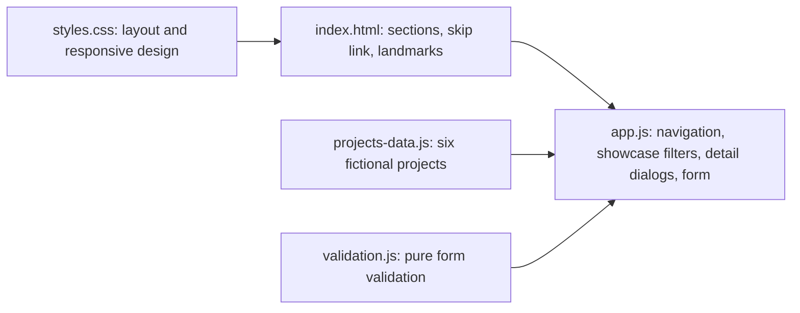

# Prompt A: Northstar Studio website

## Purpose

A responsive, accessible homepage for Northstar Studio, a fictional creative technology studio. It extends the competition's static website starter with a project showcase, service and process sections, and a validated contact form. Two versions exist: the original submission, and a Drive-aligned revision with a requirement-by-requirement traceability table against the canonical requirements document.

## Technology

| Part | Technology |
|---|---|
| Page | Semantic HTML5 |
| Styling | CSS, responsive layout, reduced-motion support |
| Behaviour | Dependency-free JavaScript |
| Tests | Python `unittest` (structure, HTTP, starter checks, optional Playwright browser checks) and Node's built-in test runner (validation logic) |

## Architecture



- **Navigation:** a collapsible mobile menu that closes on Escape, link selection or an outside click.
- **Showcase:** cards rendered from `projects-data.js`, with category filters and accessible detail dialogs.
- **Contact form:** inline errors, focus on the first invalid field, a message-length counter and a local confirmation; nothing is sent to a server.
- **Accessibility:** skip link, visible focus rings, live announcements, labelled controls.

## Commands

```bash
python -m http.server 8000                                  # then open http://localhost:8000
python -m unittest discover -s tests -p "test_*.py" -v      # structure, HTTP and logic checks
node --test tests/test_logic.mjs                            # validation logic
python -m unittest tests.test_browser -v                    # browser checks at 390 px and 1440 px (needs Playwright and Chromium)
```

## Test results (6 November 2026, offline)

| Suite | Original | Drive-aligned |
|---|---|---|
| Python `unittest` | 15 tests: 10 passed, 5 browser checks skipped (Playwright not installed) | 15 tests: 10 passed, 5 skipped |
| Node `--test` | 6 of 6 passed | 6 of 6 passed |

## Provenance

Prepared independently of DevPilot AI's runs. The package is kept outside this repository; see [the competition overview](../README.md).
