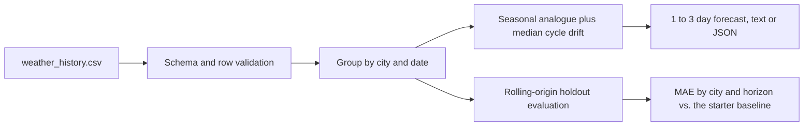

# Prompt B: synthetic temperature forecasting

## Purpose

A command-line application that forecasts temperatures 1 to 3 days ahead for the cities in the competition's synthetic weather dataset, and measures its accuracy with a leakage-free, time-ordered evaluation. The data is generated sample data for the competition, so the forecasts are a software exercise, not real weather forecasts.

## Technology

| Part | Technology |
|---|---|
| Application | Python 3 standard library: `csv`, `datetime`, `statistics`, `argparse`, `json` |
| Tests | Python `unittest`, including the starter's original tests |
| Data | The supplied CSV of three cities, 42 daily observations each |

## Architecture



- **Method:** the dataset repeats on a roughly 12-day cycle. A forecast takes the most recent observation a whole number of cycles earlier and adds the median drift per cycle, measured on training history only; without an analogue it falls back to the mean of the previous three observations.
- **Evaluation:** for each of the last nine days and each horizon, the model is fitted only on earlier data, so no target leaks into training. The original three-observation baseline is kept for comparison.
- **Preserved starter:** the original `load_rows` and `predict_temperature` functions and all supplied records are unchanged.

## Commands

```bash
python -m weather_app --list-cities
python -m weather_app --city Tokyo --days 3
python -m weather_app --demo
python -m unittest discover -s tests -v
```

## Test results (6 November 2026, offline)

`python -m unittest discover -s tests`: **20 of 20 passed**.

## Provenance

Prepared independently of DevPilot AI's runs. The package is kept outside this repository; see [the competition overview](../README.md).
