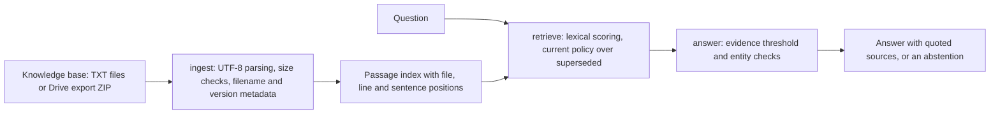

# Prompt C: document-grounded question answering

## Purpose

An offline question-answering assistant over a fictional company's policy and service documents. It retrieves the passages that answer a question, composes the answer from the retrieved sentences themselves, cites the file and line of each, prefers the current version of a superseded policy, and abstains when no document supports an answer.

## Technology

| Part | Technology |
|---|---|
| Application | Python 3 standard library, no package installation |
| Retrieval | Local BM25-style lexical scoring with synonym normalisation |
| Answers | Extractive composition from retrieved sentences, with an evidence threshold |
| Input | A folder of TXT documents, or the original Google Drive export ZIP |
| Tests | Python `unittest` |

## Architecture



## Commands

```bash
python -m rag_app --list-documents
python -m rag_app --question "What is the current domestic hotel reimbursement limit?"
python -m rag_app --demo
python -m rag_app --demo --json
python -m rag_app --kb <Drive export ZIP> --demo
python -m unittest discover -s tests -v
```

## Test results (6 November 2026, offline)

`python -m unittest discover -s tests`: **32 of 32 passed**.

## Provenance

Prepared independently of DevPilot AI's runs; delivered inside the Prompt D evidence pack. The package is kept outside this repository; see [the competition overview](../README.md).
