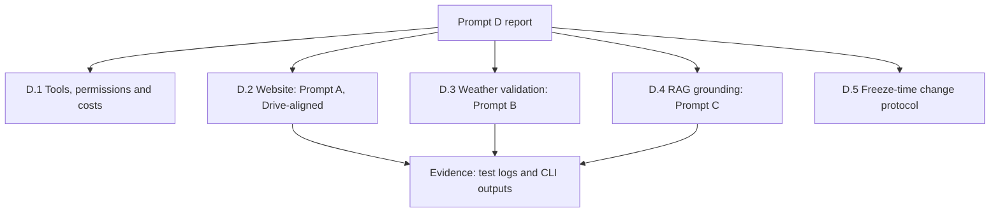

# Prompt D: explicability and evaluation evidence

## Purpose

The evidence pack that explains how the other three prompts were approached: which tools were chosen and why, what each costs and needs, how the weather results and the RAG answers were validated, and how a change announced at freeze time would be handled.

## Structure

| Section | Covers |
|---|---|
| D.1 Tool assessment | The selected tools, the permissions each needs, connectivity checks and costs, in a report and a CSV |
| D.2 Website | The Drive-aligned Prompt A website, traced requirement by requirement to the canonical specification |
| D.3 Weather validation | Forecast outputs, holdout accuracy and the handling of invalid cities and horizons |
| D.4 RAG grounding | Citations, version selection between current and superseded policies, and abstention |
| D.5 Freeze-time change | The protocol for a change introduced at freeze time |
| Evidence | Test logs, CLI outputs and environment checks for each project |

## Test results (6 November 2026, offline)

The pack bundles the three projects, whose suites were run from it:

| Bundled project | Result |
|---|---|
| Prompt A, Drive-aligned website | Python: 10 passed, 5 browser checks skipped; Node: 6 of 6 passed |
| Prompt B, weather forecasting | 20 of 20 passed |
| Prompt C, grounded question answering | 32 of 32 passed |

## Provenance

Prepared independently of DevPilot AI's runs. The pack is kept outside this repository; see [the competition overview](../README.md).
